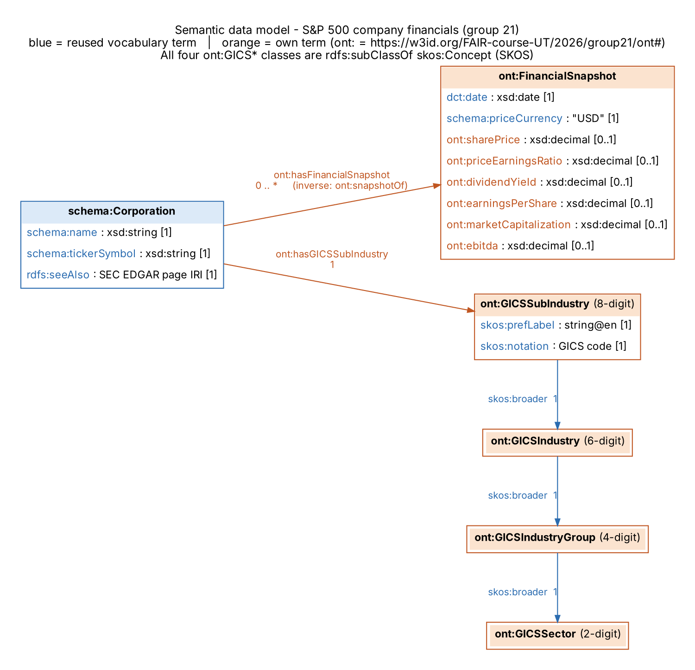

# FAIRification of the S&P 500 company financials dataset

Project for **FAIR Data Engineering (University of Twente, 2025-2026)**, group 21 (Priyansh Bansal).

The dataset [S&P 500 Companies with Financial Information](https://datahub.io/core/s-and-p-500-companies-financials)
(DataHub Core Datasets, ODC-PDDL-1.0) is taken through the FAIRification process: it is described with DCAT
metadata, converted to RDF using a semantic data model, given persistent w3id identifiers and published with its
metadata in a FAIR Data Point.

## Persistent identifiers (w3id)

| Identifier | Resolves to | Content |
|---|---|---|
| `https://w3id.org/FAIR-course-UT/2025-2026/group21/ont` | `ontology/group21-ont.ttl` | Mini ontology + GICS concept scheme (base for `ont#...` terms) |
| `https://w3id.org/FAIR-course-UT/2025-2026/group21/data` | `data/rdf/sp500-financials.ttl` | FAIRified dataset (base for `data#...` resources) |
| `https://w3id.org/FAIR-course-UT/2025-2026/group21/data-original` | `data/original/constituents-financials.csv` | Original file as downloaded |

Hash URIs are used: `.../data#company-AAPL` resolves to the document `.../data`, which describes `#company-AAPL`.

## Repository layout

```
data/
  original/constituents-financials.csv    original file (DataHub, retrieved 2026-10-24, file dated 2026-10-23)
  original/datapackage.json               original metadata (Frictionless Data Package)
  cleaned/sp500-financials-cleaned.csv    10 kept columns + GICS sub-industry code
  cleaned/gics-structure.csv              GICS 2023 hierarchy used for the mapping
  rdf/sp500-financials.ttl                FAIRified dataset (7,806 triples)
ontology/
  group21-ont.ttl / group21-ont.owl       semantic data model (Turtle / RDF-XML for Protege)
metadata/
  schemas/dataset-shape.ttl               SHACL metadata schema - dataset
  schemas/distribution-original-shape.ttl SHACL metadata schema - original CSV distribution
  schemas/distribution-rdf-shape.ttl      SHACL metadata schema - RDF distribution
  records/                                metadata records exported from the FAIR Data Point
queries/                                  SPARQL competency questions (+ results)
scripts/                                  clean.py, triplify.py, ontology-core.ttl
docs/                                     data model diagram
```

## Semantic data model



* Reused: `schema:Corporation`, `schema:name`, `schema:tickerSymbol`, `schema:priceCurrency`, `dct:date`,
  `rdfs:seeAlso`, SKOS (`skos:Concept`, `skos:broader`, `skos:notation`, `skos:prefLabel`).
* Own terms (`ont:`): `FinancialSnapshot`, the four GICS level classes, `hasGICSSubIndustry`,
  `hasFinancialSnapshot` / `snapshotOf`, and six indicator properties (`sharePrice`, `priceEarningsRatio`,
  `dividendYield`, `earningsPerShare`, `marketCapitalization`, `ebitda`).

## Reproduce

```bash
pip install pandas rdflib pyshacl
python scripts/clean.py       # original CSV -> cleaned CSV
python scripts/triplify.py    # cleaned CSV  -> ontology + RDF
```

## Data preparation decisions

* Kept 10 of 14 columns; dropped 52-week low/high, price/sales and price/book (same modelling pattern, fewer properties).
* The column `Sector` holds **GICS sub-industries** (127 distinct values), not the 11 GICS sectors, although the
  original metadata calls it "GICS sector classification". All 127 values were matched to their 8-digit GICS code,
  which also gives sector, industry group and industry through `skos:broader`.
* 17 companies (e.g. Ansys, Hess, Juniper Networks, Marathon Oil) have no financial values; they keep their company
  triples but get no snapshot. Missing values are omitted, never set to 0. 46 P/E values are missing (mostly negative earnings).

## Competency questions

| # | Question | Query |
|---|---|---|
| CQ1 | Total market capitalisation per GICS sector? | `queries/cq1-market-cap-per-sector.rq` |
| CQ2 | Which sector has the highest average P/E? | `queries/cq2-pe-per-sector.rq` |
| CQ3 | Which companies yield > 3 % dividend with positive EPS? | `queries/cq3-high-dividend-profitable.rq` |
| CQ4 | Which companies are headquartered outside the US? (needs Wikidata) | `queries/cq4-federated-wikidata.rq` |

## Licence

Data: ODC-PDDL-1.0 (as the source). Ontology, metadata and scripts: CC BY 4.0.
